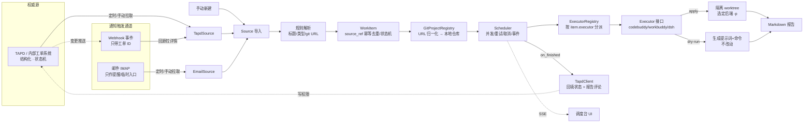

# CheerlyTaskAgent 架构设计

> 交付链路：**手动新建 / 邮箱 / TAPD 的需求或 bug → 映射到本地仓库 → 本地 CLI agent（codebuddy / workbuddy / dsh，按任务选择）改代码 → 结果落本地报告。**
> 目标仓库 `cheerly-plan/CheerlyTaskAgent`（绿地）。本阶段不接大模型，规划交给规则，调度交给确定性代码。

---

## 0. 定位与边界

**它是"工单调度台"，不是"画师"，也不是"规划大脑"。**

| 它做 | 它不做（本阶段） |
|---|---|
| 手动新建 / TAPD 权威源自动接入（Webhook + 定时拉取）/ 邮件兜底，规则提取标题/类型/git 地址 | 不接 LLM 自动拆任务（后续） |
| git URL 归一化，映射到本地 checkout | 不改 git 历史、不提交、不 push |
| 派发 `codebuddy -p` 在映射仓库执行 | — |
| 执行完成后回填 TAPD 状态 + 报告评论 | 邮件不回填（无状态机），只作通知 / 临时入口 |
| 幂等、并发、重试、取消、事件流、Markdown 报告 | apply 用 worktree 隔离执行；成功后自动把改动同步到主仓库工作区（不 commit/push，不改 git 历史） |

**环境事实（决定了设计）**
- 编码 CLI：本机已装 `@tencent-ai/codebuddy-code`（提供 `codebuddy`，默认执行端）。执行层已抽象为三类后端接口；`workbuddy` / `dsh` 遵循同一 CLI 协议，在「系统设置 → 执行后端」填入其二进制路径并启用后即可用，未配置时不受分派。
- `CheerlyHarness`（`cheerly`）是流式 chat harness，只有 `now`/`calc` 工具，不能直接改代码；`dsh`（deepseek-harness）是另一套。二者本阶段不接。
- Agent Mail 已连接但未开通，暂用样例邮件/manual；邮件走 IMAP 兜底。TAPD 通过开放 API（Basic Auth）接入，为权威数据源；凭据 / 权限需用户自行申请（写权限用于状态回填）。

---

## 1. 总架构

## 2. 组件职责

| 组件 | 职责 |
|---|---|
| `sources.py` | `RawItem`（邮件/TAPD/manual）→ `WorkItem`。规则：标题前缀判 bug/需求、关键词兜底、正则提取 git URL、去签名/引用。`TapdSource` 把 `TapdItem` 映射为 RawItem，source_ref=`tapd:<type>:<id>` 作幂等键。 |
| `tapd.py` | TAPD 开放 API 客户端（权威源）：Basic Auth（应用ID:秘钥），公网 `api.tapd.cn` / 内网 `apiv2.tapd.woa.com`。`GET /stories`、`GET /bugs`（workspace_id + limit≤200 + page + modified>游标 + 可选 status）分页拉取并归一化为 `TapdItem`；`fetch_one()` 供 Webhook 回源拉单条；`POST /stories|/bugs` 回填 status + current_user，`POST /comments` 写报告评论。同步阻塞 IO，调用方用 `asyncio.to_thread`；未配置/网络错误进 `TapdResult.error` 不抛崩服务。 |
| `mailpoll.py` | IMAP 兜底接入（临时入口/通知）：用标准库 imaplib 拉收件箱未读邮件（只读）、解析 MIME 正文/编码头，转成 `EmailSource.from_mailtool` 的 dict 形状；凭证来自 UI 设置，失败只返回错误不抛异常。`api.py` 的 `pull_mail_now()` 复用它建单（message-id 幂等），手动端点 `/api/mail/pull` 与 lifespan 后台定时任务共用；开关/间隔/模式存 `mail_poll` 设置，默认关闭、5 分钟、dry-run。接入 TAPD 后建议保持关闭。 |
| `gitmap.py` | 扫描根目录 git 仓库的 `origin`，`normalize_git_url` 把 HTTPS/SSH/SCP/裸地址统一成 `host/owner/repo`，`resolve()` 映射到 `LocalRepo`。 |
| `models.py` | `WorkItem` 状态机 `discovered→ready→queued→running→succeeded/failed/skipped/cancelled`；`RunResult`、`LocalRepo`；`executor` 字段记录任务用哪类后端（缺省 codebuddy，旧数据兼容）。 |
| `scheduler.py` | 导入去重（`source_ref`）、`create_manual`（手动指定项目直接 ready）、映射、按 `item.executor` 从 `ExecutorRegistry` 取后端派发、幂等、并发上限、退避重试、取消、事件发射。确定性代码，无 LLM。 |
| `executor.py` | `Executor` 统一接口（`run`/`build_command`/`changed_files`/`commit_files`/`describe`）+ 三类真实后端 `CodeBuddyExecutor`/`WorkBuddyExecutor`/`DshExecutor`（共用 worktree/commit/sync 管线，仅二进制与标识不同）+ `ExecutorRegistry`（按 id 取，未知 id 回退 codebuddy）。三类都走 `<backend> -p --output-format json` 非交互协议：`dry-run` 只生成 argv；`apply` 建 git worktree、受限权限、超时、抓 changed_files；成功后 `sync_to_repo()` 以 worktree HEAD 为 base 做三方比较同步回主仓库（主仓库未分叉才覆盖，分叉则尝试干净合并、否则记冲突并备份双方；路径校验/忽略规则）。argv 列表拼接防命令注入。 |
| `backends.py` | 依据持久化的 UI `backends` 配置构建 `ExecutorRegistry`（每类后端一套独立 profile：命令/模型/超时/自动同步/启用），并向 `/api/config` 输出后端清单。 |
| `report.py` | 每单生成精简 Markdown：概览、执行结果、改动文件、自动同步明细与备份位置、错误；codebuddy 原始 stdout 只提取最终结论、提示词/命令/输出放折叠附录（`
`），避免动辄 10 万字符。`render_report` 也供 `/api/items/{id}/report` 实时渲染，老报告一并精简呈现（磁盘 .md 存档不动）。前端轻量 Markdown 渲染器把表格/标题/折叠块结构化展示。 |
| `events.py` / `api.py` | 事件总线 + SSE（沿用 Harness 帧格式）；HTTP 路由。 |
| `web/`（源码）+ `src/taskagent/web/`（构建产物） | 调度台前端：Vite + React 18 + TypeScript + Tailwind + shadcn/ui。四 Tab（任务列表 / 项目映射 / 数据源 / 系统设置），「+ 新建任务」弹窗只做**手动录入**；「数据源」Tab 是接入中心——TAPD 卡（主源）配置 workspace/API 凭证/Webhook 地址+secret/拉取类型/回填状态/定时开关 + 「立即同步」，邮件卡（兜底）配置 IMAP + 自动拉取 + 「立即拉取」；含工作项看板、dry-run/apply/report。产物由 FastAPI 托管且不入仓，需先 `taskagent web-build`。 |

## 3. 关键流程

**导入**：邮件 subject/body → `parse_raw`：前缀【BUG】/【需求】优先分类 → 正则提取 git URL → `dedupe_key = source_ref`（邮件 id） → 已存在则跳过（幂等）→ `gitmap.resolve()` 映射本地仓库，成功 = `ready`，失败 = `discovered`（可手动映射）。

**手动新建**：`create_manual(title, description, kind, repo_name)` → 用户显式指定类型与项目 → 项目映射优先解析为 `LocalRepo` → 直接置 `ready`；`dedupe_key` 为随机值，因此同名手动任务不会互相去重。界面三个入口对应：创建草稿（`run_now=false`）、创建并 dry-run、创建并 apply（`approved=true`）。

**执行**：`run(id, exec_mode, model)`。`dry-run` 直接生成命令；`apply` 要求 `approved=true`，建 worktree，`codebuddy -p` 在 worktree cwd 执行，收集 stdout/改动文件。**模型**：`WorkItem.model` 为按任务选择的模型（`build_command` 里 `item.model or executor.model`），新建时可选、卡片上可随时切换；`model=None` 回退全局 `CODEBUDDY_MODEL`。候选由 `config.CODEBUDDY_MODELS`（`codebuddy --help` 真实列表）提供，`TASKAGENT_MODELS` 可收窄。apply 成功后 `sync_to_repo()` 把改动文件**自动同步回主仓库工作区**：归一化路径→忽略规则过滤（复用 commit 规则）→拒绝绝对路径/`..`/符号链接逃逸→覆盖或删除前先备份到 `<data_dir>/sync-backups/<item>/<时间>/`；结果写入 RunResult 与报告，失败不否定 apply 本身。`TASKAGENT_AUTO_SYNC=0` 可关闭。只重试可重试错误（timeout/429/5xx）。

**恢复**：状态与报告落盘；进程重启后可从 `data/tasks` 重建；`running` 中断的项后续可加 lease 重派（当前为手动重跑）。

## 4. 安全设计

1. **默认只读**：dry-run 是默认且唯一的开箱模式；apply 必须审批。
2. **隔离执行**：apply 用 `git worktree add -b taskagent/<id>`（失败回退 `git archive`/快照）。建好沙箱后会把主仓库**当前工作区的未提交状态**（相对 HEAD 的 tracked 改动 + 未跟踪的非忽略文件）叠加进去并 commit 成新基线，因此 codebuddy 看到的是用户当前的代码，而非过期的已提交 HEAD——从源头避免"基于旧代码改完又撞上主仓库新代码"的假冲突（叠加失败则安全回退到纯 HEAD 基线）。codebuddy 只在隔离沙箱里跑。成功后改**文件**自动同步回主仓库工作区（可控、带备份），但**不产生 git 副作用**。同步采用三方比较（base=worktree HEAD / ours=主仓库当前 / theirs=codebuddy 结果）：主仓库自 base 未变才覆盖；已分叉则尝试 `git merge-file` 干净合并，冲突则不覆盖、备份 `.main`/`.codebuddy` 并报告，避免过期 worktree 回滚主仓库后续改动。
3. **不产生 git 副作用**：提示词明确要求"不提交、不 push、不改无关文件"；自动同步只落工作区文件，不 stage、不 commit、不 push，由用户自行审查后提交。
4. **防注入**：邮件文本放在 `--- TASK START/END ---` 分隔符内并要求忽略越权指令；命令用 `argv` 列表，`shell=False`。
5. **凭证**：不入库；codebuddy 自身登录态由 CLI 管理。

## 5. 选型对比

| 决策 | 选项 | 结论 |
|---|---|---|
| 任务解析 | 规则 / LLM | **规则**：本阶段不接大模型，前缀+关键词+正则足够 |
| 执行端 | 单一 codebuddy / 多后端 | **三类后端按类型各一套配置**：CodeBuddy（兜底，始终启用）/ WorkBuddy / DSH；统一 `Executor` 接口 + 注册表，任务按 `executor` 字段分派 |
| 状态存储 | JSON / SQLite | **JSON**（沿用 Harness SessionStore 原子写）；量大了换 SQLite |
| 权威数据源 | 邮件 / TAPD | **TAPD**（结构化、状态机、Webhook 可闭环）；邮件只作通知/兜底，非可信源 |
| 结果回填 | 本地报告 / 回邮件 / TAPD | **本地报告 + TAPD 状态/评论**（需写权限）；邮件不回填（无状态机） |
| 并发 | 串行 / 多并发 | **默认 1**（codebuddy 重），可配 |

## 6. 成本与延迟（粗估，价格以官网为准）

- 邮件解析/映射：本地计算，毫秒级，零成本。
- codebuddy 调用：按 CLI 背后模型计费；单次可能数分钟（复杂 bug 更久），`CODEBUDDY_TIMEOUT` 默认 600s。
- dry-run：零成本，秒级——适合先审阅提示词。

## 7. 风险与应对

| 风险 | 应对 |
|---|---|
| 自动改代码改错/改坏 | dry-run 默认 + worktree 隔离 + 审批 + 报告审阅；自动同步带路径校验/忽略规则/覆盖前备份，可 `TASKAGENT_AUTO_SYNC=0` 关闭；不 commit/push |
| 邮件文本 prompt 注入 | 分隔符包裹 + 忽略越权指令 + argv 非 shell |
| git 映射错仓库 | 归一化 + 后缀匹配；支持手动映射；报告写明映射结果 |
| codebuddy 未安装 | 明确报错并给出安装命令；可配 npx |
| 邮箱未开通 | 样例邮件/manual 跑通；EmailSource 接口就绪 |
| TAPD 通知不含正文 | Webhook 只带工单 ID，收到后必须 `fetch_one()` 回源拉详情，不靠通知内容执行 |
| TAPD 权限不足 | 读/写权限分开；无写权限时回填失败只记 warning，不影响本地执行结果（best effort） |
| 单进程无锁 | 单人使用；并发上限 1；后续加 per-item 锁 |

## 8. 落地状态与下一步

**已完成**：规则解析、git 映射、项目映射配置、新建任务合并进任务列表（按钮 + 弹窗，选项目即可 dry-run/apply）、去重、dry-run/apply 执行器、worktree、报告、SSE、UI、邮件 IMAP 兜底接入、**TAPD 主源接入（Webhook + 定时拉取 + 幂等建单 + 状态/评论回填）**、**多执行后端（Executor 统一接口 + codebuddy/workbuddy/dsh 三类独立配置 + 任务按 executor 分派）**、测试全绿（82 passed）、mock 端到端闭环验证通过。

**下一步（按优先级）**：
1. 申请 TAPD 应用凭证 + 项目授权（读 + 写权限），在「数据源」Tab 填入并开启；在 TAPD 后台配置 Webhook 事件订阅。
2. 装 codebuddy CLI，先用 dry-run 审提示词，再对低风险仓库小范围 apply。
3. 如需接内部自研工单 Web：有开放 API 则复用 TAPD 同一套适配器扩展；只能人工看页面则不适合自动化。
4. 邮箱保持关闭（仅通知/兜底）；如需 Agent Mail，开通后接真实 `ListMessages` → `/api/import/emails`。
5. 可选：接 LLM 做需求拆解与补丁审阅。

## 9. 待确认

- 邮箱开通后，按哪些条件拉邮件（未读 / 关键词 / 发件人白名单）？
- 真实 apply 时允许 codebuddy 用哪些工具（Bash 是否放开）？
- 报告是否需要汇总成每日摘要？
