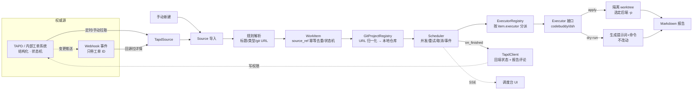

# CheerlyTaskAgent 架构设计

> 交付链路：**手动新建 / TAPD 的需求或 bug → 映射到本地仓库 → 本地 CLI agent（codebuddy / dsh，按任务选择）改代码 → 结果落本地报告。**
> 目标仓库 `cheerly-plan/CheerlyTaskAgent`（绿地）。本阶段不接大模型，规划交给规则，调度交给确定性代码。

---

## 0. 定位与边界

**它是"工单调度台"，不是"画师"，也不是"规划大脑"。**

| 它做 | 它不做（本阶段） |
|---|---|
| 手动新建 / TAPD 权威源自动接入（Webhook + 定时拉取），规则提取标题/类型/git 地址 | 不接 LLM 自动拆任务（后续） |
| git URL 归一化，映射到本地 checkout | 不改 git 历史、不提交、不 push |
| 派发 `codebuddy -p` 在映射仓库执行 | — |
| 执行完成后回填 TAPD 状态 + 报告评论 | 不接邮件数据源（非结构化、无状态机、无法回填） |
| 幂等、并发、重试、取消、事件流、Markdown 报告 | apply 用 worktree 隔离执行；成功后自动把改动同步到主仓库工作区（不 commit/push，不改 git 历史） |

**环境事实（决定了设计）**
- 编码 CLI：本机已装 `@tencent-ai/codebuddy-code`（提供 `codebuddy`）。执行层已抽象为可增删的后端，遵循同一非交互 CLI 协议；在「系统设置 → 执行后端」配置任意二进制路径并启用后即可用，任务按 `executor` 字段分派到对应后端。
- `CheerlyHarness`（`cheerly`）是流式 chat harness，只有 `now`/`calc` 工具，不能直接改代码；`dsh`（deepseek-harness）是另一套。二者本阶段不接。
- 任务来源为手动录入或 TAPD。TAPD 通过开放 API（Basic Auth）接入，为唯一外部数据源；凭据 / 权限需用户自行申请（写权限用于状态回填）。邮件数据源已移除。

---

## 1. 总架构

## 2. 组件职责

| 组件 | 职责 |
|---|---|
| `sources.py` | `RawItem`（TAPD/manual）→ `WorkItem`。规则：标题前缀判 bug/需求、关键词兜底、正则提取 git URL、去签名/引用。`TapdSource` 把 `TapdItem` 映射为 RawItem，source_ref=`tapd:<type>:<id>` 作幂等键。`RawItem.from_email` 仅作 demo/测试的轻量构造器保留。 |
| `tapd.py` | TAPD 开放 API 客户端（权威源）：Basic Auth（应用ID:秘钥），公网 `api.tapd.cn` / 内网 `apiv2.tapd.woa.com`。`GET /stories`、`GET /bugs`（workspace_id + limit≤200 + page + modified>游标 + 可选 status）分页拉取并归一化为 `TapdItem`；`fetch_one()` 供 Webhook 回源拉单条；`list_projects(nick, company_id)` 调 `/workspaces/user_participant_projects` 拉用户参与的项目列表（需真人 nick，非应用 ID）供 UI 选 workspace_id；`POST /stories|/bugs` 回填 status + current_user，`POST /comments` 写报告评论。`TapdConfig.__post_init__` 统一 strip 所有字符串字段，防止复制凭证带入首尾空白导致 401。同步阻塞 IO，调用方用 `asyncio.to_thread`；未配置/网络错误进 `TapdResult.error` 不抛崩服务。 |
| `gitmap.py` | 扫描根目录 git 仓库的 `origin`，`normalize_git_url` 把 HTTPS/SSH/SCP/裸地址统一成 `host/owner/repo`，`resolve()` 映射到 `LocalRepo`。 |
| `projectmap.py` | 用户维护的「项目名/别名 → 本地文件夹」映射（`data/projects.json`），中文子串/英文词边界匹配、多命中取最长、可停用。`ProjectMapping` 带 `tapd_workspace_id`，`find_by_workspace()` 供 TAPD 建单时反查绑定的本地仓库——实现 TAPD 项目 ↔ 本地映射双向关联（数据源页与映射页改的是同一份数据）。 |
| `models.py` | `WorkItem` 状态机 `discovered→ready→queued→running→succeeded/failed/skipped/cancelled`；`RunResult`、`LocalRepo`；`executor` 字段记录任务用哪类后端（缺省 codebuddy，旧数据兼容）；`ProjectMapping.tapd_workspace_id` 记录绑定的 TAPD 项目。 |
| `scheduler.py` | 导入去重（`source_ref`）、`create_manual`（手动指定项目直接 ready）、映射、按 `item.executor` 从 `ExecutorRegistry` 取后端派发、幂等、并发上限、退避重试、取消、事件发射。`import_raw(repo_name=...)` 支持显式指定仓库（TAPD workspace 绑定映射时优先于文本匹配）。确定性代码，无 LLM。 |
| `executor.py` | `Executor` 统一接口（`run`/`build_command`/`changed_files`/`commit_files`/`describe`/`list_models`） + 通用机制（worktree/commit/sync/超时/取消）+ `ExecutorRegistry`（按 id 取，未知 id 回退默认后端）。**方言隔离**：每个 CLI 的四层差异（调用 / 模型发现 / 能力探测 / 成功判定）收敛到 `dialect.py` 的封闭策略库——`FlagInjector`（codebuddy 的 `--model`）、`DshPatchInjector`（DSH 覆盖层，内置逃生）、`LocalCacheCatalog`/`HelpRegexCatalog`/`ProfileYamlCatalog`、`StrictVerdict`/`NdjsonStrictVerdict`；新增 CLI = 组合已有策略，不做配置化小语言。两类都走 `<backend>` 非交互协议：`dry-run` 只生成 argv；`apply` 建 git worktree、受限权限、超时、抓 changed_files；成功后 `sync_to_repo()` 三方比较同步回主仓库。DSH 协议不同：`dsh --profile headless [--patch …] --json`，权限预设有 `read-only/workspace-write/danger-full-access` 三档（`acceptEdits` 自动映射到 `workspace-write`）。 |
| `backends.py` | 依据持久化的 UI `backends` 配置构建 `ExecutorRegistry`（每类后端一套独立 profile：命令/模型/超时/自动同步/启用），并向 `/api/config` 输出后端清单。 |
| `report.py` | 每单生成精简 Markdown：概览、执行结果、改动文件、自动同步明细与备份位置、错误；codebuddy 原始 stdout 只提取最终结论、提示词/命令/输出放折叠附录（`
`），避免动辄 10 万字符。`render_report` 也供 `/api/items/{id}/report` 实时渲染，老报告一并精简呈现（磁盘 .md 存档不动）。前端轻量 Markdown 渲染器把表格/标题/折叠块结构化展示。 |
| `events.py` / `api.py` | 事件总线 + SSE（沿用 Harness 帧格式）；HTTP 路由。 |
| `web/`（源码）+ `src/taskagent/web/`（构建产物） | 调度台前端：Vite + React 18 + TypeScript + Tailwind + shadcn/ui。四 Tab（任务列表 / 项目映射 / 数据源 / 系统设置），「+ 新建任务」弹窗只做**手动录入**；「数据源」Tab 仅 TAPD 卡——配置 API 凭证、项目 ID（手填或填 nick 后「拉取项目」下拉选择）、关联本地项目映射、Webhook 地址+secret/拉取类型/回填状态/定时开关 + 「立即同步」；映射表也显示并可编辑「关联 TAPD 项目」，两处双向同步；含工作项看板、dry-run/apply/report。产物由 FastAPI 托管且不入仓，需先 `taskagent web-build`。 |

## 3. 关键流程

**导入**：TAPD 工单（或手动录入）→ `RawItem` → `parse_raw`：前缀【BUG】/【需求】优先分类 → 正则提取 git URL → `dedupe_key = source_ref`（`tapd:<type>:<id>` 或手动随机值）→ 已存在则跳过（幂等）→ 映射本地仓库：若该 TAPD workspace 绑定了本地项目（`ProjectMapping.tapd_workspace_id`），直接归到该仓库（**绑定优先**）；否则 `projectmap.resolve_text()` 按别名匹配 → `gitmap.resolve()` 按 git 回退，成功 = `ready`，失败 = `discovered`（可手动映射）。

**手动新建**：`create_manual(title, description, kind, repo_name)` → 用户显式指定类型与项目 → 项目映射优先解析为 `LocalRepo` → 直接置 `ready`；`dedupe_key` 为随机值，因此同名手动任务不会互相去重。界面三个入口对应：创建草稿（`run_now=false`）、创建并 dry-run、创建并 apply（`approved=true`）。

**执行**：`run(id, exec_mode, model)`。`dry-run` 直接生成命令；`apply` 要求 `approved=true`，建 worktree，`<backend> -p` 在 worktree cwd 执行，收集 stdout/改动文件。**模型**：`WorkItem.model` 为按任务选择的模型（`build_command` 里 `item.model or executor.model`），新建时可选、卡片上可随时切换；`model=None` 回退该后端的 `model` 字段。候选列表不再写死——由默认执行后端 `Executor.list_models()` 动态解析其 CLI `--help` 的 `--model` 参数实时获取，`TASKAGENT_MODELS` 环境变量可收窄候选；`/api/config` 的 `default_model` 即默认后端的 `model` 字段，新建任务据此回填（全局默认选了哪个就回填哪个）。apply 成功后 `sync_to_repo()` 把改动文件**自动同步回主仓库工作区**：归一化路径→忽略规则过滤（复用 commit 规则）→拒绝绝对路径/`..`/符号链接逃逸→覆盖或删除前先备份到 `<data_dir>/sync-backups/<item>/<时间>/`；结果写入 RunResult 与报告，失败不否定 apply 本身。`TASKAGENT_AUTO_SYNC=0` 可关闭。只重试可重试错误（timeout/429/5xx）。

**恢复**：状态与报告落盘；进程重启后可从 `data/tasks` 重建；`running` 中断的项后续可加 lease 重派（当前为手动重跑）。

## 4. 安全设计

1. **默认只读**：dry-run 是默认且唯一的开箱模式；apply 必须审批。
2. **隔离执行**：apply 用 `git worktree add -b taskagent/<id>`（失败回退 `git archive`/快照）。建好沙箱后会把主仓库**当前工作区的未提交状态**（相对 HEAD 的 tracked 改动 + 未跟踪的非忽略文件）叠加进去并 commit 成新基线，因此 codebuddy 看到的是用户当前的代码，而非过期的已提交 HEAD——从源头避免"基于旧代码改完又撞上主仓库新代码"的假冲突（叠加失败则安全回退到纯 HEAD 基线）。codebuddy 只在隔离沙箱里跑。成功后改**文件**自动同步回主仓库工作区（可控、带备份），但**不产生 git 副作用**。同步采用三方比较（base=worktree HEAD / ours=主仓库当前 / theirs=codebuddy 结果）：主仓库自 base 未变才覆盖；已分叉则尝试 `git merge-file` 干净合并，冲突则不覆盖、备份 `.main`/`.codebuddy` 并报告，避免过期 worktree 回滚主仓库后续改动。
3. **不产生 git 副作用**：提示词明确要求"不提交、不 push、不改无关文件"；自动同步只落工作区文件，不 stage、不 commit、不 push，由用户自行审查后提交。
4. **防注入**：任务文本放在 `--- TASK START/END ---` 分隔符内并要求忽略越权指令；命令用 `argv` 列表，`shell=False`。
5. **凭证**：不入库；codebuddy 自身登录态由 CLI 管理。

## 5. 选型对比

| 决策 | 选项 | 结论 |
|---|---|---|
| 任务解析 | 规则 / LLM | **规则**：本阶段不接大模型，前缀+关键词+正则足够 |
| 执行端 | 单一 codebuddy / 多后端 | **后端配置驱动**：可自由增删后端（新装种子 codebuddy/dsh 均可删可禁，无特权）；统一 `Executor` 接口 + 注册表，任务按 `executor` 字段分派；缺失/禁用后端回退到用户配置的默认后端，无后端时报错 |
| 状态存储 | JSON / SQLite | **JSON**（沿用 Harness SessionStore 原子写）；量大了换 SQLite |
| 权威数据源 | 邮件 / TAPD | **仅 TAPD**（结构化、状态机、Webhook 可闭环）；邮件数据源已移除——非结构化、无法回填 |
| 结果回填 | 本地报告 / TAPD | **本地报告 + TAPD 状态/评论**（需写权限） |
| 并发 | 串行 / 多并发 | **默认 1**（codebuddy 重），可配 |

## 6. 成本与延迟（粗估，价格以官网为准）

- 规则解析/映射：本地计算，毫秒级，零成本。
- codebuddy 调用：按 CLI 背后模型计费；单次可能数分钟（复杂 bug 更久），`CODEBUDDY_TIMEOUT` 默认 600s。
- dry-run：零成本，秒级——适合先审阅提示词。

## 7. 风险与应对

| 风险 | 应对 |
|---|---|
| 自动改代码改错/改坏 | dry-run 默认 + worktree 隔离 + 审批 + 报告审阅；自动同步带路径校验/忽略规则/覆盖前备份，可 `TASKAGENT_AUTO_SYNC=0` 关闭；不 commit/push |
| 任务文本 prompt 注入 | 分隔符包裹 + 忽略越权指令 + argv 非 shell |
| git 映射错仓库 | 归一化 + 后缀匹配；支持手动映射；报告写明映射结果 |
| codebuddy 未安装 | 明确报错并给出安装命令；可配 npx |
| TAPD 通知不含正文 | Webhook 只带工单 ID，收到后必须 `fetch_one()` 回源拉详情，不靠通知内容执行 |
| TAPD 权限不足 | 读/写权限分开；无写权限时回填失败只记 warning，不影响本地执行结果（best effort） |
| 单进程无锁 | 单人使用；并发上限 1；后续加 per-item 锁 |

## 8. 落地状态与下一步

**已完成**：规则解析、git 映射、项目映射配置、新建任务合并进任务列表（按钮 + 弹窗，选项目即可 dry-run/apply）、去重、dry-run/apply 执行器、worktree、报告、SSE、UI、**TAPD 唯一外部数据源接入（Webhook + 定时拉取 + 幂等建单 + 状态/评论回填）**、**多执行后端（Executor 统一接口 + codebuddy/dsh 两类独立配置 + 任务按 executor 分派 + 模型动态探测）**、**方言策略库（四层封闭策略 + DSH 内置逃生 + 严格执行证据）**、**设置保存热生效**、测试全绿、mock 端到端闭环验证通过。

**下一步（按优先级）**：
1. 申请 TAPD 应用凭证 + 项目授权（读 + 写权限），在「数据源」Tab 填入并开启；在 TAPD 后台配置 Webhook 事件订阅。
2. 装 codebuddy CLI，先用 dry-run 审提示词，再对低风险仓库小范围 apply。
3. 如需接内部自研工单 Web：有开放 API 则复用 TAPD 同一套适配器扩展；只能人工看页面则不适合自动化。
4. 可选：接 LLM 做需求拆解与补丁审阅。

## 9. 待确认

- 真实 apply 时允许 codebuddy 用哪些工具（Bash 是否放开）？
- 报告是否需要汇总成每日摘要？
