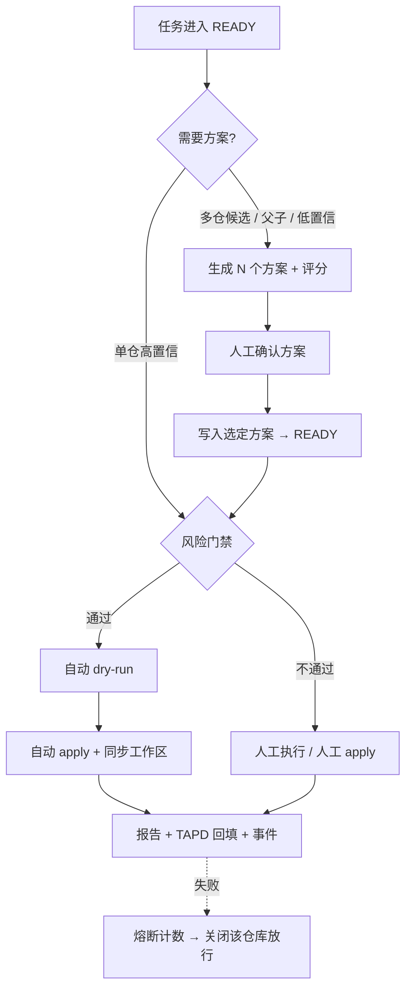

# 自动执行与方案选择设计

> 目标：把任务中心从「人工点执行 → 人工点 apply」的半自动调度台，升级为**低风险任务自动落地 + 复杂需求多方案择优**的执行系统。
>
> 已确认的决策：
> - 自动化档位 = **低风险自动 apply**（自动出队 + 自动 dry-run + 自动 apply；**不 commit、不 push**，提交与推送仍人工）。
> - 方案选择 = **多方案 + 评分**（生成 N 个候选方案，确定性评分推荐，人确认后执行）。
> - 本轮交付 = **详细设计文档**（本文），评审通过后再进入实现。
>
> 状态：**设计中，未实现**。文中的新状态、配置段、数据表、端点、UI 目前都不存在。

---

## 0. 定位与边界

### 0.1 一句话定位

它仍然是「工单调度台」，不是「自主 Agent」。本设计补的是两件事：**让确定安全的任务自己走完执行**，以及**让不确定的任务先摆出几个方案让人拍板**。LLM 不在本轮引入执行链路；方案生成第一版用规则，评分全部用确定性代码。

### 0.2 做什么 / 不做什么

| 做 | 不做（本轮） |
|---|---|
| READY 任务自动出队，按风险门禁决定是否自动 apply | 不自动 commit / push / 建 PR（保持现有安全语义） |
| 通过门禁的任务自动执行 dry-run → apply → 同步工作区 | 不自动拆父需求为子任务（父子编排见另文档，本轮只做「父子任务先出方案」） |
| 复杂需求生成 N 个候选方案 + 确定性评分 + 人工确认 | 不接 LLM 做方案生成或代码审阅（留作 Planner 的后续 provider） |
| 方案确认后自动进入执行流水线 | 不取消现有人工入口：手动执行 / apply / 取消全部保留 |
| 熔断、白名单、改动量阈值、失败自动停放行 | 不改 git 历史，不碰 worktree / 三方同步的安全机制 |

### 0.3 现状事实（代码核对，2026-11-23）

| 事实 | 证据 |
|---|---|
| 状态机 `discovered→ready→queued→running→succeeded/failed/skipped/cancelled` | `models.py:32-48, 287-304` |
| 执行入口 `run(item_id, exec_mode, approved, ...)` 是同步方法，人工调用；`apply` 强制 `approved=true` | `scheduler.py:344-393`，硬校验在 `:385-386` |
| `run()` 把任务置 QUEUED 后 `_spawn(_execute)`，并发用 `asyncio.Semaphore(max_concurrent)` 控制，默认 1 | `scheduler.py:76, 387-392` |
| **没有任何扫描 READY 并自动调用的循环**；`tapd_poll_loop` 只同步不执行 | `api.py:608-622, 921-959` |
| `executor` apply 建 worktree、跑 CLI、抓 changed_files、成功后 `sync_to_repo()` 同步回主仓库工作区；明确不 commit/push | `executor.py:750-848, 1251`；`architecture.md:84-85` |
| 失败重试只对 timeout/429/5xx，最多 2 次 | `scheduler.py:40, 568-606` |
| 仓库路由是确定性五层（历史 → 显式 → 角色 → 文本 → needs_confirm），`needs_confirm = not repo or confidence < 0.6` | `route.py:1-14, 53-77` |
| TAPD 单仓库绑定自动指定、多仓库只列候选待人工选，选择结果记入历史 | `api.py:352-388, 1045-1054` |
| 父子关系字段 `parent_ref / parent_title / children_ids / is_container` 已在模型中，`is_container` 不进执行队列；但「父上下文注入 / 同仓串行 / 父验收」仍是设计 TODO | `models.py:224-228`；`docs/parent-child-requirements-design.md:11, 53-55` |
| 配置持久化在 `data/settings.json`，`tapd.auto_pull` 默认 false、`tapd.exec_mode` 默认 dry-run | `config.py:150-152, 290, 382, 475-477` |
| **执行起点是本地工作区**：worktree 从本地 `HEAD` 检出，再把未提交改动与未跟踪文件叠加进去；全库没有 `git fetch` / `git pull` | `executor.py:1013-1016, 912-975` |
| **同一任务重跑会复用旧 worktree**：目录非空即直接返回，不 reset，也不清理上次的改动 | `executor.py:984-985` |

**Gap 归纳**：缺自动出队循环、缺「什么能自动放行」的门禁、缺方案生成与评分、缺父子任务的方案层处理。执行器本身（worktree / 同步 / 重试 / 不 commit）无需改动即可承接自动触发。

---

## 1. 目标模型

### 1.1 两个新概念

**方案（PlanCandidate）**：针对一条任务，给出「在哪个仓库、改哪些范围、用什么思路、有什么风险」的可执行提案。一条任务可有多个候选方案，评分后推荐一个。方案是「人确认执行方向」的载体，不等于最终补丁。

**自动放行（auto-apply gate）**：一套确定性规则。任务满足全部准入条件且无一票否决项时，系统可在人工零点击的情况下走完 dry-run → apply → 工作区同步。不满足则退回人工确认，不降级为「偷偷自动 dry-run」。

### 1.2 完整链路



### 1.3 新增状态

在 `ItemStatus` 中新增两个非终态，放在 `ready` 与 `queued` 之间：

```
planning    → 方案生成中（异步，失败回退 ready 并记 stage）
plan_ready  → 方案已生成，等待人确认选定（不进执行队列）
```

状态流转约束：

- `ready --(需要方案)--> planning --(成功)--> plan_ready --(人选定)--> ready`
- `planning --(失败/超时)--> ready`，`stage` 写明「方案生成失败」，不影响原任务
- `plan_ready` 只能由人确认进入 `ready`，或人主动取消进入 `cancelled`
- 自动放行不得绕过 `plan_ready`：有未确认方案的任务一律不进门禁
- **`run()` 必须改成显式状态白名单**：只允许 `ready`（以及 dry-run 完成 / 失败重开的 rearm 路径）启动；`planning`、`plan_ready` 一律拒绝，错误信息为「该任务有待确认方案，请先选定」。
  现状 `run()` 只排终态（`scheduler.py:353`：`if item.is_terminal() and not rearmable`），而 `plan_ready` 按本设计是**非终态**，会被直接放行——手动接口、重试按钮、未来的批量操作都能绕过方案确认。
  用白名单而不是「排除终态」的原因：黑名单让**每个新增状态默认可执行**，白名单让新增状态默认不可执行，后者才是安全默认值。
- `cancel()` 保持放行：`plan_ready` 应当允许直接取消。

> 兼容性：老数据无新状态；`plan_ready` 加入 `TERMINAL_STATUSES` 吗？**不加入**——它是待办态，只是不进执行队列。历史页/任务中心的归类按「终态 + exec_mode=apply」现有逻辑不变，`plan_ready` 留在任务中心。

---

## 2. 自动执行门禁

### 2.1 准入条件（全部满足）

| # | 条件 | 判定依据 | 默认值 |
|---|---|---|---|
| 1 | 任务已 `ready` 且 `repo` 非空 | `item.status / item.repo` | — |
| 2 | 非父容器、无子依赖 | `not is_container and not children_ids` | 强制 |
| 3 | 仓库在自动放行白名单 | `automation.auto_apply_repos` 包含 `repo.name` | **空 = 全部禁用** |
| 4 | 路由确定 | 单仓库绑定，或 `route.confidence ≥ 0.85` 且非 `needs_confirm` | 0.85 |
| 5 | kind 在允许集合 | `automation.allowed_kinds`，默认 `["bug"]` | 只放 bug |
| 6 | 后端可用 | `executors.resolve(item.executor)` 存在且 enabled | — |
| 7 | 同仓库无在途任务 | 调度器按 repo 分组的 running/queued 计数为 0 | 强制（沿用父子设计硬约束） |
| 8 | 熔断未触发 | 该仓库不在冷却期 | 见 §2.3 |
| 9 | 主仓工作区干净 | 目标仓库 `git status --porcelain` 为空 | 强制（见 §2.5） |
| 10 | 未落后远端 | `git fetch` 后 `HEAD..@{u}` 无提交；落后时按配置告警或阻断 | 默认告警（见 §2.5） |
| 11 | worktree 起点干净 | 无残留 worktree，或已按 §2.6 重建 | 强制（见 §2.6） |

### 2.2 一票否决（命中任一即退回人工）

| # | 否决项 | 判定 |
|---|---|---|
| 1 | 敏感关键词 | 标题+描述命中 `automation.sensitive_keywords`（默认含 migration / sql / 表结构 / 迁移 / 鉴权 / 支付 / 权限 / 删除数据） |
| 2 | 预估改动超限 | 方案的 `scope` 文件数 > `automation.max_changed_files`（默认 20）；无方案时用 kind 粗判，bug 默认放行 |
| 3 | 仓库级熔断中 | 见 §2.3 |
| 4 | 方案未确认 | `status == plan_ready` 或存在未确认方案 |
| 5 | 执行模式被显式指定为 dry-run | `item.exec_mode == "dry-run"` 且用户手动设置过（与自动放行区分：自动触发的不算） |

### 2.3 熔断

- 每个仓库维护 `failures` 计数与 `cooldown_until`。
- 自动 apply 的任务失败（含同步冲突）→ `failures += 1`；达到 `failure_threshold`（默认 2）→ 该仓库 `cooldown_minutes`（默认 60）内不再自动放行，期间任务保持 `ready` 等人工。
- 人工执行成功不重置计数（避免误判）；冷却到期后 `failures` 归零，重新参与门禁。
- 熔断状态持久化到 `data/automation-state.json`，事件 `automation_tripped` 推 UI。

### 2.4 自动放行的执行语义

通过门禁后，调度器以 `approved=true, exec_mode="apply"` 调用现有 `run()`，**不做任何执行器改动**：

1. 先记 `auto_stage=auto-dry-run` 并跑一次 dry-run（保留提示词审阅产物与报告）。
2. dry-run 成功且无新增否决项 → 立即 `run(..., apply, approved=true)`，记 `auto_stage=auto-apply`。
3. 失败/否决/熔断 → 任务置 `failed` 或保留 `ready`，`stage` 写明原因，发事件，绝不静默。
4. 全程与人工执行共用同一报告、事件、TAPD 回填路径；报告顶部标注「自动放行」及命中的门禁条件。

> 关键：**自动 apply 仍不产生 git 副作用**。改动只同步到主仓库工作区，用户自行审查提交。这是「低风险自动 apply」与「全自动到 PR」的分界线。

---

### 2.5 仓库就绪检查（新增门禁）

自动 apply 的终点是 `sync_to_repo()`——**把改动直接写进你的本地主仓库工作区**（不 commit、不 push）。这一步是逐文件三方合并：主仓仍等于 base 就直接覆盖，改过就尝试合并，冲突则**跳过该文件**并继续写其他文件。

因此「无人值守时主仓是否处于可安全写入的状态」必须先判定，否则会出现**没有报错、但主仓已被改成半新半旧**的情况。

#### 2.5.1 检查项

| 检查 | 命令 | 不满足时 |
|---|---|---|
| 主仓干净 | `git -C <repo> status --porcelain` | 阻断：任务留在 `ready`，`stage` 写「主仓有未提交改动，转人工」 |
| 未落后远端 | `git -C <repo> fetch --quiet` + `git rev-list --count HEAD..@{u}` | 落后 N 且主仓干净 → 可 ff-only 快进（可配）；落后且脏 → 阻断 |
| 远端可判定 | `git rev-parse --abbrev-ref @{u}` | 无 upstream 时跳过本项，仅记录 |

**为什么必须查「脏」**：门禁不查时，若你正在主仓改 `app-context.tsx`（未提交），自动任务同时改了这个文件：

1. 三方合并「成功」→ agent 改动**悄悄叠在**你的未提交改动上；
2. 冲突 → 这个文件跳过，**其余文件照写**，主仓一半新一半旧；
3. 删除文件（`sync_deleted`）→ 主仓该文件有你的改动就跳过，但别的删除已生效。

三种结果都**不会报错**，报告里只有一节「同步冲突」，而自动执行时没人在看报告。

#### 2.5.2 边界约定

- **只作用于自动链路**；人工点 apply 不受影响（人在场可自行判断）。
- 未跟踪文件（`??`）**计入「脏」**：agent 新建同名文件时会直接覆盖你的未跟踪文件。
- 检查对象是本次写入的目标仓库 `item.repo.path`，不是全局。

### 2.6 执行起点与 worktree 生命周期

现状：worktree 从本地 `HEAD` 检出后，会把主仓的未提交改动与未跟踪文件叠加进去，并提交成 `baseline: current working tree`（`executor.py:912-975`）。这个 baseline 同时是同步时三方合并的 base。

两个必须处理的点：

1. **不拉取远端**：执行用的永远是「你本机工作区」的代码。单人开发时这是正确语义（不会把你的工作区覆盖成远端状态），但多人在同一仓库协作时，agent 可能基于**旧代码**改动。是否允许 `ff-only` 快进见 §2.5 与 §8。
2. **worktree 复用不 reset**（`executor.py:984-985`）：同一任务 dry-run → apply、失败重试，都会复用同一目录。上次 agent 改过的文件、失败留下的半成品仍在里面，会导致 `changed_files` 混入历史残留。

约定：

- 每次执行前**重建 worktree**，或按 `item.id + attempt` 命名，不复用带改动的目录；
- 复用只在「目录为空 / 仅 `.git`」时发生（现状 `_dir_has_content` 的判断语义需要收紧）；
- 报告里记录本次执行使用的 base 提交（`git rev-parse HEAD`）与是否叠加了本地改动，便于事后追溯。

---

## 3. 多方案 + 评分

### 3.1 什么时候必须出方案

| 场景 | 判定 | 处理 |
|---|---|---|
| 多仓库候选 | 路由 `needs_confirm` 或 `candidates` 长度 > 1 | 强制方案，候选方案各绑定一个候选仓库 |
| 父子需求 | `parent_ref` 非空或 `children_ids` 非空 | 强制方案，方案需说明父上下文如何传递、同仓是否串行 |
| 配置要求 | `automation.require_plan_for_all = true` | 所有任务强制方案 |
| 人工触发 | 任务卡片「生成方案」 | 任意任务可手动出方案 |
| 其余 | 单仓库、高置信、非父子 | 跳过方案，直接进门禁（可配置 `require_plan_for_all` 改变） |

### 3.2 方案数据结构

```python
@dataclass
class PlanCandidate:
    id: str                      # 本地生成 id
    repo: str                    # 目标仓库名
    scope: list[str]             # 预计改动的文件/模块路径
    approach: str                # 实现思路（1-3 句）
    risks: list[str]             # 风险点
    parent_context: str = ""     # 父子需求时注入的父上下文摘要
    serial_group: str = ""       # 同仓串行分组键，默认 repo 名
    score: float = 0.0           # 评分总分 0..1
    score_detail: dict[str, float] = field(default_factory=dict)
    source: str = "rule"         # rule | llm（本轮只有 rule）
```

落盘：任务级 `data/plans/<item_id>.json`，`WorkItem` 只存 `plan_candidate_ids` 与 `selected_plan_id`，避免主状态文件膨胀。方案内容随报告一起呈现。

### 3.3 方案生成（规则版 Planner）

`Planner` 抽象接口：`generate(item, context) -> list[PlanCandidate]`。本轮实现 `RulePlanner`：

1. **候选仓库集**：单仓库绑定 → 1 个；多仓库 → 取路由 `candidates` 前 N 个（默认 3）。
2. **改动范围**：从标题/描述正则提取明确点名的文件/模块路径；无明确路径时按角色画像（前端/后端/移动端）给默认模块范围，并在 `risks` 标注「范围未明确」。
3. **实现思路模板**：按 `kind` 与角色选模板（bug → 定位复现→修复→补回归；需求 → 新增能力→接线→验证）。模板是可维护的文本常量，不伪装成 LLM 输出。
4. **父子上下文**：`parent_ref` 非空时，把父需求标题+描述摘要拼进 `parent_context`，并把同仓库子任务标 `serial_group`。
5. **风险点**：敏感关键词、范围未明确、多仓库、父子、低置信路由 → 逐条写入。

> 后续 LLM provider：实现同一接口即可，不改评分、状态机、UI。本轮不接。

### 3.4 评分（确定性）

总分 = 加权和，权重可在配置调整：

| 维度 | 权重 | 算法 |
|---|---|---|
| 历史命中 | 0.30 | 同 TAPD 项目 + 业务词历史上人工选过该仓库 → 1.0，否则 0 |
| 路由置信度 | 0.25 | `route.confidence`（候选仓库按各自路由分） |
| 范围可控性 | 0.20 | `scope` 文件数越少越高：`1 - min(1, len(scope)/max_changed_files)` |
| 风险惩罚 | 0.15 | `1 - min(1, len(risks)/5)` |
| 依赖清晰度 | 0.10 | 父子任务：父上下文非空且串行组明确 → 1.0；普通任务 → 1.0 |

- 得分最高者标 `recommended=true`，但不自动执行——`plan_ready` 必须等人确认。
- 分数并列时按仓库名排序保证稳定；评分明细写入方案 JSON 与报告，可解释。
- `score_threshold`（默认 0.7）只用于 UI 提示「推荐 / 仅供参考」，不作为自动放行依据。

### 3.5 人确认与回写

- UI 在任务详情展示方案列表：仓库、范围、思路、风险、评分条、推荐标记；按钮「选用此方案」。
- 选定后：`selected_plan_id` 写入，`scope` 并入任务描述尾部供提示词使用，`repo` 按方案设定，`status=ready`，`stage` 记「已选用方案 X」。
- 选仓库类方案时，复用现有 `POST /items/{id}/map` 的历史学习路径，把选择记入路由历史，下次该业务词自动命中第 1 层。

---

## 4. 配置设计

在 `data/settings.json` 增加顶层 `automation` 段（`config.py` 的 `load/save_ui_settings` 需做归一化与默认值）：

```json
{
  "automation": {
    "enabled": false,
    "auto_apply_repos": [],
    "allowed_kinds": ["bug"],
    "sensitive_keywords": ["migration", "sql", "表结构", "迁移", "鉴权", "支付", "权限", "删除数据"],
    "max_changed_files": 20,
    "route_confidence_min": 0.85,
    "require_plan_for_all": false,
    "plan_candidate_count": 3,
    "score_weights": {
      "history": 0.30, "confidence": 0.25,
      "scope": 0.20, "risk": 0.15, "dependency": 0.10
    },
    "score_threshold": 0.7,
    "failure_threshold": 2,
    "cooldown_minutes": 60
  }
}
```

**安全默认**：`enabled=false`、`auto_apply_repos=[]`。即使 `enabled=true`，白名单为空时无任何任务会被自动放行——必须显式点名仓库才生效。

配置变更走现有「保存即热生效」路径；系统设置页加一个「自动化」分区，复用现有表单组件，不新增提示文案之外的说明块（沿用用户要求的干净页面风格）。

---

## 5. 数据模型变更

全部为可选字段 / 新增文件，向后兼容：

| 位置 | 变更 |
|---|---|
| `models.py` `ItemStatus` | 新增 `PLANNING`、`PLAN_READY` |
| `models.py` `WorkItem` | 新增 `auto_approved: bool = False`、`auto_stage: str = ""`、`plan_candidate_ids: list[str] = []`、`selected_plan_id: str = ""` |
| `models.py` `summary()/to_dict()/from_dict()` | 同步序列化新字段（老数据缺字段走默认值） |
| `config.py` `normalise_ui_settings` | 增加 `automation` 段归一化与白名单/权重校验 |
| 新文件 `planner.py` | `PlanCandidate`、`Planner` 接口、`RulePlanner`、评分函数 |
| 新文件 `automation.py` | `AutoGate`（准入/否决判定）、`CircuitBreaker`（熔断状态读写与冷却） |
| `scheduler.py` | 新增 `dispatch_ready()` 自动出队方法；`run()` 增加内部调用参数标识自动来源；按 repo 分组的在途计数 |
| `api.py` | `tapd_poll_loop` 与 Webhook 成功后触发 `dispatch_ready()`；新增方案生成/选方案端点；系统设置透传 automation 配置 |
| `events.py` / SSE | 新增 `plan_generated`、`plan_selected`、`auto_queued`、`auto_applied`、`automation_tripped` 事件 |
| `report.py` | 报告顶部标注自动放行/方案来源；方案与评分明细作为折叠附录 |
| `web/src/lib/api.ts` | 新增 `AutomationConfig` 类型、方案相关端点与类型 |
| `web/src/app-context.tsx` | 方案生成/选择动作、自动化配置保存、新事件刷新 |
| `web/src/pages/settings-page.tsx` | 「自动化」配置分区 |
| 任务详情页 | 方案列表与「选用此方案」按钮 |
| `tests/` | 门禁规则、评分、熔断、状态流转、方案确认后执行的单测与端到端 |

---

## 6. 关键风险与应对

| 风险 | 应对 |
|---|---|
| 自动 apply 改坏代码 | 安全默认（禁用 + 白名单空）；敏感词/改动量一票否决；worktree 隔离 + 三方同步冲突不覆盖 + 覆盖前备份；熔断自动停放行 |
| 自动放行绕过人工审批 | `approved=true` 仅由门禁内部授予，外部 API 仍强制审批；自动执行全程报告+事件可追溯；报告标注自动来源 |
| 方案生成质量低（规则模板化） | 方案只定方向不自动执行；评分明细可解释；人必须确认；LLM provider 后续可替换而不改链路 |
| 父子任务同仓并行冲突 | 方案强制 `serial_group`，调度器按仓库分组计数，同仓串行 |
| 自动执行与手动执行撞车 | 统一走 `run()`，共用 semaphore 与 repo 分组计数；手动执行优先级高于自动出队 |
| 服务重启导致自动任务中断 | 复用现有 `recover_interrupted()`；自动来源标记持久化，恢复后不重复放行 |
| 主仓有未提交改动时被自动写入 | §2.5 就绪门禁：主仓不干净一律不自动 apply，退回人工 |
| 本地落后远端，基于旧代码改动 | §2.5：执行前 `fetch` 并比较 `HEAD..@{u}`，落后时告警或阻断并在报告标注 base 提交 |
| 旧 worktree 残留污染改动清单 | §2.6：每次执行重建 worktree（或按 attempt 命名），不复用带改动的目录 |
| 配置误开导致批量自动 apply | 白名单按仓库点名；`allowed_kinds` 默认只 bug；熔断；可在系统设置一键关闭 `enabled` |

---

## 7. 分阶段实施

| 阶段 | 内容 | 可独立验收 |
|---|---|---|
| P0 | 配置段 + 数据模型 + `planner.py` / `automation.py` 骨架 + 单测 | 配置可保存、模型可序列化、门禁规则单测通过 |
| P1 | 方案生成 + 评分 + `planning/plan_ready` 状态 + UI 方案列表与选用 | 复杂需求能出方案、评分可解释、人选定后回 READY |
| P2 | `dispatch_ready()` 自动出队 + 自动 dry-run（**不放行 apply**） | READY 任务自动跑 dry-run 出报告，人工仍点 apply |
| P3 | 低风险自动 apply + 熔断 + 事件 + 报告标注 | 白名单 bug 自动落地，失败熔断，全程可追溯 |
| P4 | 后续评审：LLM Planner provider、每日汇总、自动验收 | 不在本轮范围 |

每阶段单独提交、单独验证（pytest / ruff / tsc / build），P2 是可回退的安全检查点。

---

## 8. 待确认（评审时定）

1. **方案生成的 provider**：本轮按文档用 `RulePlanner`；是否要在 P1 就直接接 LLM？（用户选择了「多方案 + 评分」但未明确 provider，本文按不接 LLM 设计，评分全是确定性代码。）
2. **自动放行来源范围**：只允许 TAPD 来源，还是手动新建任务也能自动放行？本文默认两者皆可按同一门禁，需确认。
3. **白名单维护入口**：在系统设置页手填仓库名，还是复用项目映射页的勾选？本文默认系统设置页手填。
4. **敏感词与默认 kind**：默认只放行 bug、敏感词表如上，是否符合实际业务？
5. **父子需求**：本文只在方案层处理父子（出方案、传上下文、同仓串行），父验收是否纳入本轮，还是沿用另文档 TODO？
6. **自动 dry-run 是否保留人工确认环节**：本文设计为「门禁通过 → dry-run → apply」连续执行，不再停下来等人看 dry-run；是否需要保留一个「自动 dry-run 后等人确认」的中间档？
7. **是否允许自动拉取远端**：§2.5 默认只检查不拉取（落后时告警）；是否允许在「主仓干净 + 落后」时自动 `ff-only` 快进？
8. **重跑是否重建 worktree**：§2.6 建议每次重建；代价是 dry-run 的中间产物不再被 apply 继承，是否接受？

---

## 9. 与本轮无关的既有决策

以下保持不变，不在本文讨论范围：不 commit/push、邮件数据源不接、JSON 存储、并发默认 1、执行后端配置驱动、TAPD 已关闭状态归档到历史、报告页版式。

---

## 10. 评审补充（2026-11-23 代码核对）

评审时比对了实现现状，以下问题**本文原稿未覆盖**，建议在对应阶段一并处理。

### 10.1 状态机与 `plan_ready` 的落地方式

- 建议**不改 `ItemStatus`**，改用 `WorkItem` 上的独立维度：`plan_state: '' | 'ready' | 'selected'` + `has_pending_plan: bool`。
  理由：本轮方案生成是规则版、同步即可算完，为一瞬间完成的动作引入两个状态，收益接近 0；且新增状态会牵连前端 5 处映射（`statusLabel / statusVariant / statusDot / ACTIVE_STATUSES / TERMINAL_STATUSES`）与后端多处枚举分支。
- 若坚持用状态，必须补：`recover_interrupted()` 目前只捞 `queued/running`（`scheduler.py:318-342`），服务重启后 `planning` 会**永久卡死**，需一并回收。

### 10.2 改动量阈值应使用实际值

§2.2 用「方案的 `scope` 文件数」判定改动量，但规则版 `scope` 是从标题/描述里正则抠路径、抠不到按角色给默认范围，**估得不准**。
建议两段判定：dry-run 前用估算粗筛，dry-run 后以 `result.changed_files` 的**实际数量**做最终裁决。

### 10.3 自动链路只跑一次

§2.4 设计为 `dry-run → apply` 两次真实执行。当前 `max_concurrent=1`、单次 140–500s，等于每个任务的墙钟时间翻倍。
在 worktree 隔离 + 不 commit 的前提下，建议自动链路**直接 apply 一次**，「提示词审阅产物」在执行前写入报告即可，不必额外起一次 CLI。

### 10.4 审计字段缺失

自动 apply 由门禁内部授予 `approved=true`，但 `WorkItem` 上没有记录**批准来源**。
建议增加 `approved_by: 'user' | 'gate'`（以及 `approved_at`），否则事后无法区分「人点的」和「系统自动的」。

### 10.5 敏感词误杀

默认词表含「权限」「删除数据」等高频词。`修复删除数据失败` 这类 bug 标题会被直接否决。
建议：只在**描述**上匹配，或按词频/上下文加权，并允许仓库级豁免词。

### 10.6 通知与清理

- 自动执行时人不在场，失败/熔断仅靠 SSE 事件与页面 toast，浏览器关掉就无人知晓。至少需要「下次打开时的显著横幅」，或邮件/IM 通知。
- `data/worktrees/` 与 `data/plans/` 缺少 GC，自动执行频次提高后会持续膨胀。

### 10.7 并发写入

`run()` 从请求线程调用、`_execute` 在事件循环里跑，两者都会 `store.save()`。自动出队会让并发写更频繁，建议确认存储写入是否原子、是否需要加锁。
