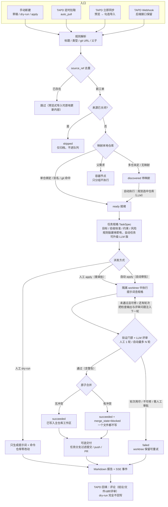
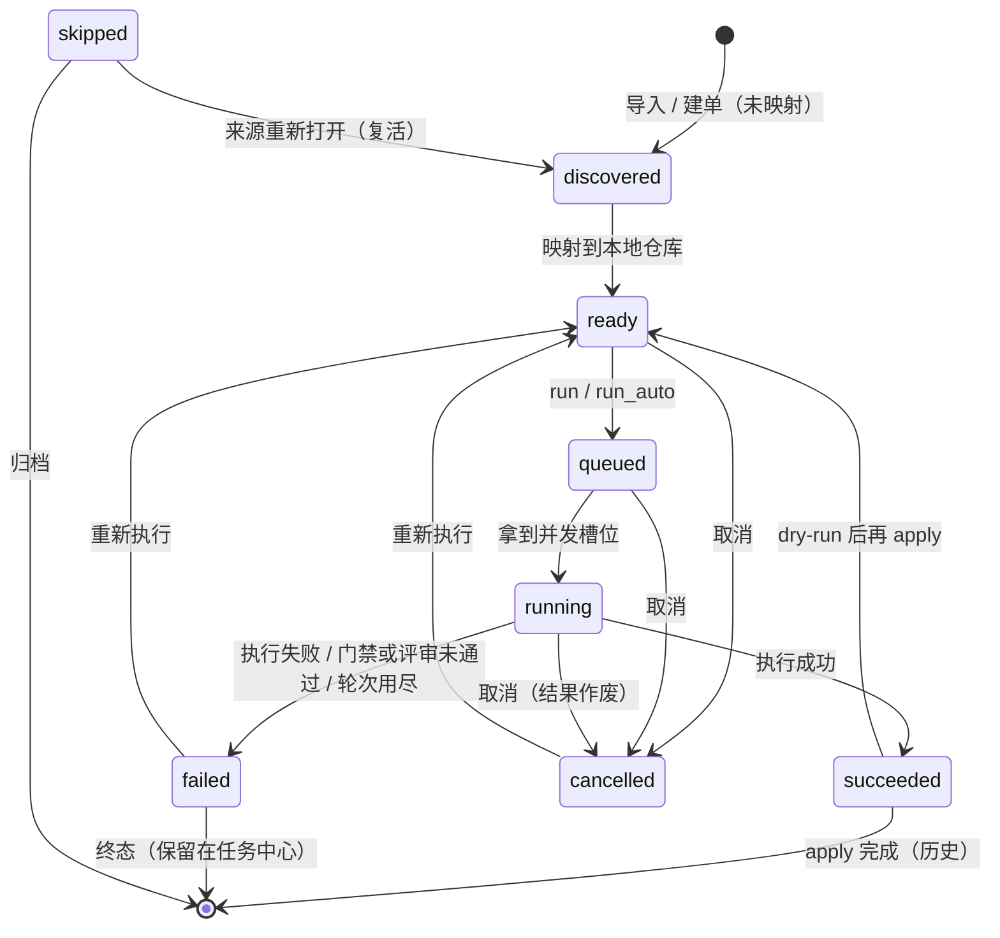
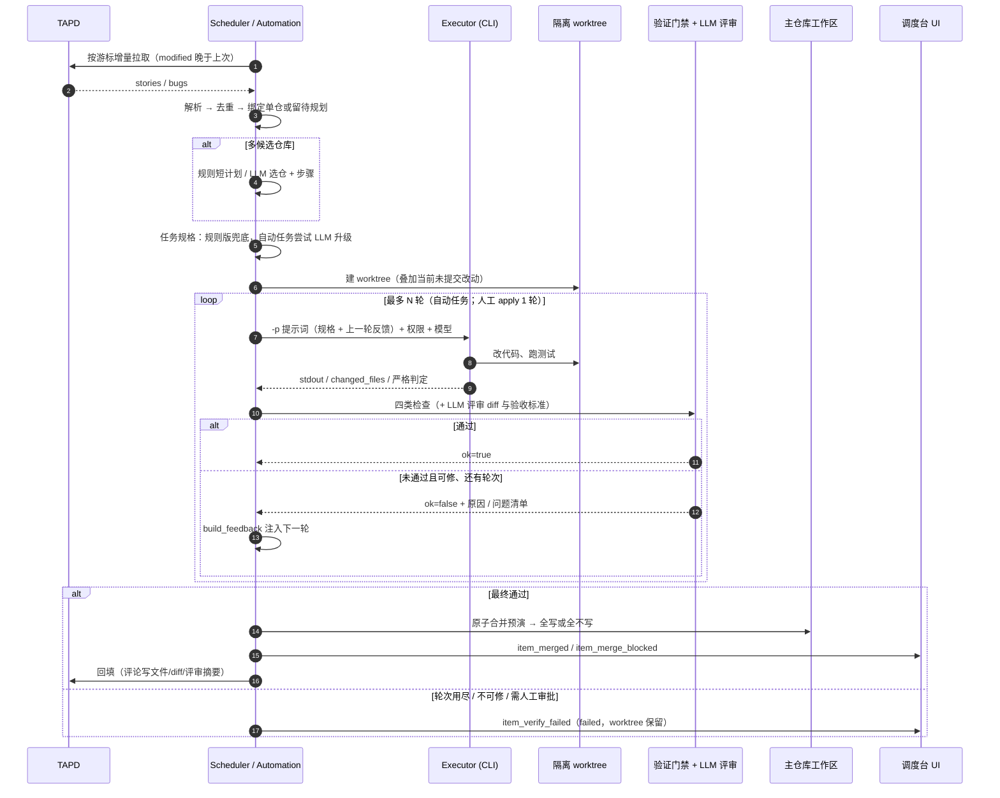

# 需求 / Bug 生命周期：从进入系统到「解决」

> 口径：**以当前代码实现为准**（`src/taskagent/` + `web/`），不写未落地的设想。
> 一句话：**工单进来 → 解析建单 → 任务规格 → 映射仓库 → 隔离执行（可多轮修复）→ 验证门禁 + LLM 评审 → 原子合并 → 报告 + 回填**。
> 相关文档：[架构设计](architecture.md)、[自动执行与选仓](auto-execution-and-plan-selection-design.md)、[父子需求](parent-child-requirements-design.md)。

---

## 0. 先定义「解决」

本系统把一件事**做完**的判定是下面五条同时成立（而不是"agent 说它改好了"）：

| # | 条件 | 证据落点 |
|---|---|---|
| 1 | 执行器在隔离 worktree 里跑通，且确实产生了文件改动（dry-run 除外） | `WorkItem.result.changed_files` |
| 2 | 有可检查的任务规格（目标/验收标准），并由评审逐条核对 | `item.spec`；`result.verification.review` |
| 3 | **apply 链路（人工 / 自动）**验证门禁通过（或被人工「强制合并」显式越过） | `result.verification.state / ok` |
| 4 | 改动**原子地**写入主仓库工作区——要么全写、要么一个文件都不写 | `item.merge_state = merged / blocked` |
| 5 | 报告落盘，TAPD 来源的工单状态回填成功 | `data/reports/<id>.md`；TAPD 状态 + 评论 |

**「解决」≠「发布」**：默认只把代码写进主仓库工作区（`git status` 里能看到），**不 commit、不 push、不开 MR、不部署**。仓库开启交付（`delivery`）后，系统会在**任务分支**上做过滤提交，按需 push 并创建 PR/MR，但仍不会自动合并远端、不会发布。

| 系统负责 | 人负责 |
|---|---|
| 拉单、去重、分类、生成任务规格、映射仓库、跑 agent、跑检查、LLM 评审、写回工作区、出报告、回填 TAPD；开启交付时提交任务分支 / push / 开 PR | 决定要不要跑、apply 的审批、冲突处理、强制合并、是否开启交付、远端合并 / 发布 |

---

## 1. 全景图


---

## 2. 入口：工单怎么进来

| 入口 | 触发者 | 后端接口 | 建单后是否立即执行 |
|---|---|---|---|
| 任务中心「+ 新建任务」→ **创建草稿** | 人 | `POST /api/tasks/manual`（`run_now=false`） | 否，留在 `ready` 等手动执行 |
| 同上 → **创建并 dry-run** | 人 | 同上（`run_now=true`，`approved=false`） | 是，只生成提示词和命令，不改仓库 |
| 同上 → **创建并 apply** | 人 | 同上（`run_now=true`，`approved=true`） | 是，在隔离 worktree 里真改代码 |
| 数据源页 **立即同步**（预览 → 勾选 → 导入） | 人 | `POST /api/tapd/preview` + `POST /api/tapd/import` | 否；导入后在任务中心手动「自动执行」或单条 apply |
| 数据源页 **定时拉取**（`auto_pull` 开） | 定时器（默认 5 分钟） | 进程内 `sync_tapd_now()` | **是**：本次新建的工单直接自动执行 |
| TAPD **Webhook** | TAPD 推送 | `POST /api/tapd/webhook`（前端表单已隐藏） | 否 |
| 程序化导入 | 脚本 / 兼容 | `POST /api/import`（旧端点） | 否 |

要点：

- **只有两个自动执行触发点**：TAPD 定时拉取拉到的新单；任务中心「自动执行」里被勾选的任务（`automation.dispatch`）。手动「立即同步」不会自动跑。
- 自动执行一律走 **apply**（`run_auto` 强制 `exec_mode="apply"` + `approved_by="auto"`），并带上 `hold_merge=True`——由 scheduler 负责验证和原子合并。
- **人工 apply 同样走验证门禁 + 原子合并**：`run()` 对所有 `apply` 置 `hold_merge=True`，执行器只写隔离 worktree，门禁通过后由 scheduler 原子合并回主仓（与自动链路同一套机制）。
- TAPD 凭据/项目/回填状态、定时开关都在「数据源」页，配置存 `data/settings.json`，即时生效。

---

## 3. 阶段 A：解析与建单

入口不同，落到同一条建单管线：`RawItem → parse_raw() → WorkItem`（`sources.py` / `scheduler.import_raw`）。

| 步骤 | 规则 | 代码 |
|---|---|---|
| 标题 | 去掉 `[BUG]` / `【需求】` / `[fix]` 类前缀；TAPD 会按实体类型补前缀 | `clean_title` |
| 类型 | 前缀优先；否则关键词计数：`bug/缺陷/报错/crash…` vs `需求/新增/支持/优化…`；都不沾为 `task` | `classify_kind` |
| 描述 | 去引用行（`>`）、去签名（`--`、`发件人`、`Regards` 等）；附件名追加到正文 | `clean_body` |
| git 线索 | 从标题+正文+来源 hint 里正则提取 git URL，供后续映射兜底 | `extract_git_urls` |
| 幂等键 | TAPD 用 `tapd:<story|bug|task>:<id>`；手动用随机 `manual:<hex>`（同名不互相去重） | `parse_raw` / `create_manual` |
| 父子 | 子需求带 `parent_ref`（父的 source_ref）和 `parent_title` 快照；父需求本身**不导入** | `RawItem.from_tapd` |
| 已关闭来源 | 直接建为 `skipped` + `stage=来源已关闭，仅归档供历史查看`，不映射、不进队列 | `import_raw(archived=True)` |

TAPD 建单的三个细节：

1. **父需求不建单**：定时拉取、预览导入、Webhook 都会跳过 `children_id` 非空的父需求；子需求按 `parent_title` 在界面分组。
2. **重复拉取不重建**：`source_ref` 命中已有条目直接跳过（`created=False`）。只有「预览 → 勾选导入」这条链路会把标题/正文变化**原地更新**到已有条目。
3. **重新打开会复活**：来源从已关闭变回活跃（如 TAPD reopened），条目从 `skipped` 回到 `discovered` 并重新映射。

建单完成后的两种落点：

- 映射上了仓库 → `ready`，可以直接执行；
- 映射不上 → `discovered`，`stage` 写明原因（"未找到本地仓库……"），等人指定。

**任务规格**在建单时同步生成（`spec.py`，规则版）：目标、可判真伪的验收标准、约束、风险等级、测试建议，存进 `item.spec`。它不依赖 LLM，任何工单都有；自动任务执行前会尝试用后端 Agent 模型升级成更贴合工单的版本（`source=llm`），失败保留规则版。

---

## 4. 阶段 B：映射本地仓库

优先级从高到低（`scheduler._map` / `import_raw`）：

1. **TAPD 项目 ↔ 本地仓库绑定**（最优先）：导入时按工单的 `workspace_id` 反查。
   - 只绑一个仓库 → 直接 `ready`。
   - 绑了多个 → 不猜。预览导入走确定性路由 `route_item`；定时拉取先留 `discovered`，等自动执行时再规划。
2. **项目名 / 别名映射**（`projectmap.resolve_text`）：在「标题 + 描述 + git URL + source_ref」里匹配；中文按子串、英文按词边界，多命中取最长，停用的不参与。
3. **git 扫描兜底**（`gitmap.resolve`）：把提取到的 git URL 和本地仓库的 `origin` 归一化成 `host/owner/repo` 再比。
4. 都不命中 → `discovered`，等人工在界面上「映射仓库」。

### 多候选仓库怎么定

两条链路用两套机制，目的相同：**判不出来就交给人，绝不瞎猜**。

| 链路 | 机制 | 判据 / 兜底 |
|---|---|---|
| 预览导入 | `route_item` 四层规则（`route.py`） | ①同一 TAPD 项目 + 相似业务词的历史人工选择 ②文本里直接点名仓库/别名 ③端别词与仓库画像角色匹配（页面/接口/小程序…）④画像文本相关度。置信度 < 0.6 或没选中 → 留空待人工 |
| 自动执行 | `planner.plan_repo`（LLM，多候选时才调用） | 把候选仓库目录/README 摘要交给「模型配置」里的后端 Agent LLM，返回选中的仓库 + 执行步骤；调用失败、返回无法解析、模型未配置 → 跳过该任务并提示手动映射 |

- 单候选不调用 LLM，直接规则版短计划（`build_short_plan`）。
- 人工在界面上选过一次仓库，会记入 `data/route-history.json`，下次同类工单优先命中历史。
- 父需求容器（`is_container`）不映射、不执行。

---

## 5. 阶段 C：派发

### 5.1 人工执行（`scheduler.run`）

| 模式 | 前提 | 行为 |
|---|---|---|
| `dry-run` | 已映射仓库 | 只拼提示词和命令落报告；仓库零改动；状态 `succeeded`，可再转 apply |
| `apply` | 已映射仓库 + **`approved=true`**（显式审批） | 建 worktree、真跑 CLI；缺审批直接拒绝（400）；完成后先过验证门禁，通过才原子合并回主仓（与自动链路一致） |

- 允许重新武装的状态：`dry-run` 成功的、`failed`、`cancelled`。重新执行会清掉旧 `result/report/attempt`，避免看板显示上一轮输出。
- 已经是 `succeeded` 的 apply 任务不会重跑（要改就新建任务或走「重新验证 / 合并」）。

### 5.2 自动执行（`automation.dispatch` → `scheduler.run_auto`）

资格判定（不满足就如实跳过并给出原因，不静默）：

| 情况 | 结果 |
|---|---|
| `auto_dispatched_at` 非空 | 跳过：已经自动执行过（幂等） |
| 父容器 / 有 `children_ids` | 跳过：不进执行队列 |
| `ready` 且已映射 | 执行 |
| `discovered` 且有候选仓库 | 先规划（规则或 LLM）→ 选中则映射并执行；选不中则跳过待人工 |
| `discovered` 且无候选 | 跳过：未映射仓库，且没有可用的候选仓库 |
| `queued` / `running` / 终态 | 跳过 |

`run_auto` 写入的字段：`auto=True`、`approved_by="auto"`、`hold_merge=True`、`exec_mode="apply"`、`plan=<计划文本>`、`auto_dispatched_at=<now>`，然后复用 `run()`。

自动任务执行时还会带上**任务规格**（规则版或 LLM 版）和**执行-反馈循环**：门禁/评审未通过时最多再修 `TASKAGENT_MAX_ROUNDS` 轮（默认 2）；人工 apply 固定 1 轮，保持「点一次跑一次」。

### 5.3 并发、重试、取消

- **锁顺序**：父需求锁 → 同仓库锁 → 全局信号量。父锁/仓库锁只作用于自动任务（人工任务不进这两把锁，互不阻塞），保证同一父需求下、或同一仓库上的自动任务串行，避免后一个任务把前一个的合并基线顶掉。
- **并发上限**：`max_concurrent`（默认 1，系统设置里改），是全局槽位。
- **失败重试**：只有可重试错误（timeout / rate / 429 / 5xx）才自动重试。默认 `max_attempts=2`，即失败后等 2s 再试一次；`retry_delays=(2s, 8s)` 里的 8s 只有在调高上限后才会用到。其余失败直接 `failed`。
- **取消**：置取消位并向 CLI 进程组发 SIGTERM（2s 后升级 SIGKILL）；状态 `cancelled`，结果作废、不合并，worktree 在进程退出后回收。
- **重启恢复**：服务启动时把遗留的 `queued/running` 标记为 `failed`（"服务重启导致执行中断"），可一键重跑。

---

## 6. 阶段 D：执行（隔离 worktree + 执行-反馈循环）

### 6.1 单轮执行

`executor.py` 的 apply 流程：

1. **建 worktree**：`data/worktrees/<仓库名>-<item_id>`，基于 `git worktree add -b taskagent/<...>`；随后把主仓库**当前未提交的改动叠加上去**，保证 agent 改的是你眼前的代码而不是过期 HEAD。建不出来时退化为 `git archive` 快照 / 目录拷贝。
2. **拼提示词**（`build_prompt`）：任务类型/标题/来源/描述 + 父需求上下文 + **任务规格（目标/验收标准/约束/风险）** + 规划步骤 + **上一轮反馈**（如果有）；明确要求"最小必要修改、不提交、不推、不改无关文件、能跑测试就报告结果"；任务正文用 `--- TASK START/END ---` 包裹，降低注入风险。
3. **选后端与模型**：任务自带 `executor` 字段决定用哪个 CLI（codebuddy / dsh / 自定义），`item.model` 覆盖后端默认模型；命令用 argv 列表拼（非 shell），任务文本无法注入命令。
4. **沙箱与权限**：`--permission-mode acceptEdits`（DSH 映射为 `workspace-write`），cwd=worktree；子进程环境只透传 `PATH/HOME/LANG/TERM…` 白名单，避免把服务端密钥带进去。
5. **超时**：默认 600s，超时 kill 并判失败。
6. **严格判定**（`StrictVerdict` / `NdjsonStrictVerdict`）：**退出码 0 不算成功**——鉴权失败、没有实际执行、空输出信封都判失败，杜绝"假成功"。
7. **收集改动**：`changed_files` 来自 worktree 的 git 状态（新增/修改/删除），后续门禁、合并、报告都用这份清单。

dry-run 不走以上步骤，只 `build_command` + 把提示词/命令写进报告。

### 6.2 执行-反馈循环（`loop.py`）

自动任务的执行不是一次性的：每轮「执行 → 验证 + 评审」，未通过时把问题变成下一轮的修复指令。

| 维度 | 规则 |
|---|---|
| 轮次 | 自动任务 `TASKAGENT_MAX_ROUNDS`（默认 2，1 = 关闭循环）；人工 apply 固定 1 轮 |
| worktree | 各轮**复用同一个 worktree**：下一轮在上一轮改动上继续修，而不是从头重做 |
| 反馈内容 | 失败原因、未通过检查的 label/退出码/输出节选、评审问题清单、状态特定要求（不改测试、缩小范围、必须产生真实改动）；≤ 4000 字符，作为「上一轮未通过」段注入提示词 |
| 可继续修 | `failed` / `review_blocked` / `test_files_changed` / `protected_files_changed` / `too_many_files` / `diff_too_large` / `no_changes` |
| 立即停止 | `unconfigured` / `incomplete` / `review_needs_human` / `error`（不是 agent 改代码能解决的，别浪费轮次） |
| 轮次用尽 | 保留最后一轮结果，任务 `failed`，stage 标注「第 N 轮」，worktree 保留供人排查/重新验证 |
| 记录 | `result.rounds`、`item.feedback`（最后一轮反馈）；报告里折叠展示 |
| 预算 | 每轮失败后检查任务 / 当日 token 预算；超限立即停止重试，任务 `failed`（不再合并） |

循环本身不碰主仓库、不合并；合并仍由 scheduler 在循环结束后做一次原子合并。

**Token 账本**：执行 CLI 的 stdout usage、后端 Agent 的规格/评审/选仓调用都会记入 `item.usage`（`cli` / `llm` 分列）并按天累加到 `data/usage.json`；执行前检查日预算，循环每轮后检查任务/日预算。超限只会停止「下一轮」，不会撤销已经通过门禁的交付。

---

## 7. 阶段 E：验证 + 评审门禁（所有 apply 链路，人工 + 自动）

位置：agent 跑完之后、原子合并之前；在同一个 worktree 里跑仓库声明的检查（`verification.run_gate`），配置了模型时再叠加 LLM 评审。**默认 fail-closed**：没配置、跑不起来、超时、动到测试/受保护文件，都算不通过，主仓一个文件都不写。

### 7.1 仓库检查（确定性）

判定按固定顺序短路：

| 顺序 | 检查 | 不通过时的 `state` |
|---|---|---|
| 1 | `TASKAGENT_VERIFY=0` 显式禁用 | `disabled`（放行，报告标注"验证已禁用"） |
| 2 | 仓库在 `data/verify.json` 里没有任何检查 | `unconfigured` |
| 3 | 改动为空 | `no_changes` |
| 4 | 改动**删除/重写/重命名**了测试/快照文件（新增、纯插入允许） | `test_files_changed` |
| 5 | 改动包含受保护文件（测试配置、CI、`package.json`/`pyproject.toml`、锁文件、`.env*`、Dockerfile…） | `protected_files_changed` |
| 6 | 改动文件数 > 上限（默认 30） | `too_many_files` |
| 7 | 四类 `test / lint / typecheck / build` 有缺失，且没在 `na` 里写理由 | `incomplete` |
| 8 | worktree 不存在 | `error` |
| 9 | 改动行数 > 上限（默认 2000） | `diff_too_large` |
| 10 | 逐个执行检查（单检查默认 300s、总 900s，失败可重试 1 次） | `failed` |
| 11 | 失败项在基线（worktree HEAD）复跑，判断是否既有失败 | `failed` / 放行加警告 |
| 12 | 全过 | `passed` / `passed_with_warnings`（flaky 重试通过、advisory 放行） |

补充：

- **测试文件允许新增或纯插入**：删除/重写已有测试、重命名、或插入 `@skip`/`@xfail` 装饰器 / `pytestmark` / `collect_ignore` 会拦（防止 agent 放宽自己的考卷），人工仍可「强制合并」；新增的测试不参与阻塞判定——test 类检查跑在临时评分 worktree（`data/verification-grading/`，基线测试文件 + agent 的非测试改动）上，新增测试再在真实 worktree 跑一遍，结果只作为 `new_tests` 告警写进报告，不阻塞合并。
- **检查命令自动生成**：启动和新增项目映射时按 `pyproject.toml`、`package.json scripts`、`go.mod`、`Cargo.toml`、`Makefile` 探测并写入 `data/verify.json`；仓库文件变了到「项目映射 → 重建画像与验证」重建。
- **N/A 有期限**：四类检查缺哪类，就在「验证配置 → 编辑 N/A」写理由 + 过期时间；过期自动失效，需重新批准。
- **失败可重试**：「重新验证」只重跑门禁（不重跑 agent），通过后按需自动合并。
- **人工兜底**：「强制合并」显式跳过门禁，`verification.override/override_by/override_at` 记入报告，自动链路永远不会用它。
- 门禁日志在 `data/verifications/`（7 天 / 2000 个文件自动回收），输出已脱敏。
- 检查进程的 `PYTHONPATH` 指向被验证 worktree 的 `src/` 与根目录：`.venv` 若是 editable 安装（指向主仓），不这样做检查会跑主仓代码而不是 agent 的改动。
- **人工 apply 与自动链路走同一套门禁**：`run()` 对所有 `apply`（包括人工单条执行）置 `hold_merge=True`，执行器只写隔离 worktree；门禁未过（含未配置、跑不起来、超时、动到测试/受保护文件）就一个文件都不写回主仓，worktree 保留供排查与「重新验证」。

### 7.2 LLM 评审（`reviewer.py`）

- **输入**：worktree diff（≤ 200,000 字符）+ **任务规格**（验收标准逐条核对）+ 改动行数；读「模型配置」里的后端 Agent 模型，与执行端 CLI 解耦。
- **输出**：`verdict`（approve / comment / block）+ `issues`（severity/file/message）+ `risks`（security、migration、breaking-change…）+ `reason`。
- **并入门禁**（`apply_review`）：

| 评审结论 | 门禁结果 |
|---|---|
| `block` | `ok=false`，`state=review_blocked`，任务留任务中心 |
| 大 diff（> 2000 行）/ 敏感文件（`.env`、CI、依赖清单、迁移、key 等）/ 高风险标签 / high·critical 问题 | `ok=false`，`state=review_needs_human`（转人工审批） |
| `comment` | 放行，但写 `warnings`，`state` 升为 `passed_with_warnings` |
| `approve` | 不改变门禁判定 |

- **降级**：模型未配置、调用超时/失败、回复无法解析 → `review.state=skipped/error`，不改变原有验证门禁，报告如实标注「未评审」。
- 关闭开关：`TASKAGENT_REVIEW=0`。
- 评审同样作用于**人工 apply** 与**自动链路**，且是反馈循环的输入之一：block 的问题清单会进入下一轮修复指令。

---

## 8. 阶段 F：合并回主仓库工作区

### 8.1 原子合并（人工 / 自动 apply 共用，`sync_to_repo(atomic=True)`）

1. **预演（preflight）**：对每个改动文件做三方比较——`base`（worktree HEAD）、`ours`（主仓库当前文件）、`theirs`（agent 结果）。
   - 主仓自 base 以来没动 → 可直接覆盖/删除；
   - 主仓也动了 → 先试 `git merge-file` 三方合并，无冲突才算通过。
2. **只要有一个文件冲突 → 全部不写**（`merge_state=blocked`，任务 `succeeded` 但留在任务中心，带「合并冲突」标记）；worktree 保留供排查。
3. **全部通过 → 一次性写入**，状态 `succeeded`、`merge_state=merged`，随后回收 worktree、清理备份。
4. 路径安全：只碰改动文件、过滤忽略规则（`.env`、`data/`、venv 等）、拒绝绝对路径 / `..` / 符号链接逃逸；覆盖或删除前先备份到 `data/sync-backups/<item>/<时间>/`。
5. 冲突后人工点「合并」重试（`merge_item`）；仍冲突就继续 blocked。人工强制合并只在这一步存在。

### 8.2 人工 apply 的合并

人工 apply 不再由 executor 逐文件同步：与自动任务一样走上面的原子合并——门禁通过后无冲突才写入主仓，有冲突则一个文件都不写、保留 worktree 供「重试合并」或「强制合并」。失败后修好配置可通过「重新验证」重跑门禁（不重跑 agent），通过后自动合并。

默认无论人工还是自动，都**不 commit、不 push**；开仓库交付后按 8.3 在任务分支上提交（仍不自动合并远端）。后端另有带过滤规则的 `/api/items/{id}/commit*` 接口，当前界面未接入，不属于主链路。

### 8.3 可选交付（`delivery.py`，默认关闭）

交付只发生在**合并成功之后**（顺序不能反：提交会移动 worktree HEAD，也就是三方合并的基线），且只对 `apply` 生效：

| 模式 | 行为 |
|---|---|
| `off` | 保持原样：只写工作区，不产生提交 |
| `commit` | 在隔离 worktree 的任务分支（`taskagent/<仓库>-<id>`）上做**过滤提交**：只 `git add` commit 规则允许的文件，被过滤的文件不 stage 不提交；不切主仓分支、不动主仓 HEAD；分支保留供 review |
| `push` | commit 后 `git push --set-upstream <remote> <branch>`（用本机 git 凭据） |
| `pr` | push 后按远端域名创建 GitHub PR / GitLab MR（`GITHUB_TOKEN` / `GITLAB_TOKEN`；企业版可用 `TASKAGENT_DELIVERY_API_BASE`） |

- 开关：仓库映射的 `delivery` 字段覆盖全局 `TASKAGENT_DELIVERY`；`""` = 跟随全局。
- 合并冲突（`blocked`）时仍会提交任务分支，但**不 push / 不建 PR**；处理完冲突点「合并」重试后会自动补交付。
- 交付失败（push 被拒、缺 token、PR 被拒）**不会回滚已经落地的本地合并**：`item.delivery` 记录错误，报告与 TAPD 评论可见；`POST /api/items/{id}/deliver` 可重试。
- 分支在 workspace 回收时保留（`keep_branch`），方便 `git log taskagent/...` review 或手工 cherry-pick。

---

## 9. 阶段 G：报告与回填

### 报告

每单一份 `data/reports/<id>.md`（`report.py`），实时可通过 `GET /api/items/{id}/report` 渲染：

- 概览（ID、类型、来源、状态、执行模式、模型、映射仓库、批准来源）；
- 需求描述；
- **任务规格**（目标、验收标准、约束、风险、规则/LLM 来源）；
- 执行结果（成功、dry-run、耗时、改动文件数、**执行轮次**、worktree）；
- **Token 用量**（CLI / 后端 Agent / 合计）；
- **交付**（模式、任务分支、提交、push、PR/MR、错误）；
- 验证（状态、原因、每个检查的命令/耗时/退出码/输出摘要）+ **LLM 评审**（结论/问题清单/风险标签）；
- 多轮执行时的「最后一轮反馈」；
- 合并状态与自动同步明细（已同步/已删除/冲突/备份目录）；
- 最终结论摘要、执行命令、完整提示词、stderr（折叠附录）；
- 错误。

### TAPD 回填（`backfill.py`）

只在 `tapd.enabled`、有 `source_ref`、且**不是 dry-run** 时执行；写权限由用户的 TAPD 凭据决定。回填拆成两个互相独立的副作用（`backfill_result`）：

**1. 结果评论（仅 apply 链路）**

```
【TaskAgent】已完成 / 未完成 / 未合并 / 已强制合并（跳过验证）
任务：<标题>（缺陷/需求/任务）
来源：tapd:bug:123
执行后端：codebuddy；模型：后端默认
原因：<未完成时写；验证/合并失败的具体原因>
状态：<stage，例如"完成（已自动合并 3 个文件到工作区）">
执行轮次：2 轮（含自动修复）
评审：通过（0 个问题）
改动文件（N）：
- src/a.py
- web/b.tsx
改动内容（diff 节选）：
<diff，按 1900 字符预算截断，文件清单在前保证不被切掉>
```

评论先发、状态后写，单个失败不影响另一个——避免"状态改成功了但评论没发出去"的静默结果。评论**不写本机报告路径**（TAPD 上的人打不开，只会成为噪音）；看改动就看评论里的 diff，看完整上下文回调度台。

**2. 状态写回（仅 apply）**

- **dry-run 完全不回写**：它只生成提示词和命令、不碰代码，既**不写状态**，也**不发评论**。给来源工单留一条"我没改代码"的评论只是噪音，同一条工单还可能被反复 dry-run；需要看方案就在调度台看本机报告。
- 成功判定：`result.ok && merge_state != "blocked" && 验证通过`（无门禁时视为通过）。成立 → `status_on_success`（默认 `resolved`）；不成立 → `status_on_failure`（默认空 = 不改）。
- 冲突后人工「合并」成功、或「重新验证」通过并合并时，会补一次回填。

---

## 10. 收尾：历史、归档与资源回收

- **历史 vs 任务中心**（前端判定）：`apply` 且终态、非 `failed`、非 `merge_state=blocked` → 历史记录；`failed` 和合并冲突的任务留在任务中心，方便直接重试。
- **来源关闭** → `skipped` 归档（历史可见）；来源重新活跃 → 复活重跑。
- **worktree**：合并成功或取消后删除；合并冲突时保留（供重试/排查）。
- **备份**：`sync-backups` 按保留天数/每任务份数回收，启动时也扫一遍。
- **删除任务**：`DELETE /api/items/{id}`（界面确认后执行）。

---

## 11. 状态机



终态集合：`succeeded / failed / skipped / cancelled`。其中只有 `failed`、`cancelled` 可重新武装（外加 dry-run 成功的 `succeeded`）。

> 自动任务的 `succeeded` 还要看 `merge_state`：`merged` 才算真正交付进工作区；`blocked` 虽然执行成功，但代码没进主仓，仍留在任务中心待处理。

| 字段 | 含义 |
|---|---|
| `status` | 上述状态机 |
| `stage` | 人话进度/原因，直接显示在界面与报告（"验证中…"、"完成（已自动合并 N 个文件…）"） |
| `merge_state` | `""`（未走原子合并）/ `merged` / `blocked` |
| `hold_merge` | True = 执行器不同步，交给 scheduler 做验证 + 原子合并（所有 apply：人工 + 自动） |
| `auto` / `approved_by` | 是否自动派发 / 谁批准的 apply（`user` / `auto`） |
| `auto_dispatched_at` | 自动派发幂等标记 |
| `attempt` / `max_attempts` | 执行尝试次数 / 上限 |
| `result.verification` | 门禁结论（`ok` / `state` / `reason` / `checks` / `override`），配置了模型时含 `review` 子结论 |
| `result.diff` | agent 改动 diff 节选（合并会删 worktree，所以执行后立刻留档，供评论/排查用） |
| `result.rounds` | 本次执行跑了几轮 agent（>1 说明反馈循环修过） |
| `usage` | 本次执行的 token 账本：`cli` / `llm` 各自的输入、输出、合计、调用次数 |
| `delivery` | 交付结果：`mode/branch/commit/pushed/pr_url/error` |
| `result.usage` | 最后一轮 CLI 的 token 用量（逐轮排查用） |
| `spec` | 任务规格：目标 / 验收标准 / 约束 / 风险 / 来源（rule·llm） |
| `feedback` | 最后一轮未通过的原因（下一轮提示词 / 报告用；重新执行时清空） |
| `plan` / `parent_context` | 规划步骤 / 父需求上下文（执行时注入提示词） |

---

## 12. 失败分支速查

| 现象 / `stage` | 状态 | 系统做了什么 | 人该做什么 |
|---|---|---|---|
| 未找到本地仓库 / 待映射 | `discovered` | 不动 | 「映射仓库」或新增项目映射 |
| 多仓待确定 | `discovered` + 候选列表 | 不猜仓库 | 人工选仓；或配置后端 Agent 模型让自动规划 |
| 没有可用的执行后端 | `failed` | 直接失败，提示去系统设置 | 启用/新增后端后重新执行 |
| agent 超时 / 429 | 自动重试后仍失败 | 等 2s 重试一次（默认上限 2 次） | 重新执行或排查 CLI |
| 退出码 0 但鉴权失败 / 无实际执行 | `failed` | 严格判定拦下"假成功" | 检查 CLI 登录态 |
| 验证未配置 | `failed`（`unconfigured`） | 主仓不写，worktree 保留；循环立即停止（不是 agent 能修的） | 补 `verify.json` / 重建画像 → 重新验证 |
| 验证失败（测试/检查不过） | `failed` | 自动任务会把失败输出注入下一轮，最多 N 轮；仍不过则失败、主仓不写 | 修代码或环境 → 重新验证；急用可强制合并 |
| 动到了测试/受保护文件 | `failed` | 反馈里明确要求别改；轮次用尽仍犯则失败 | 让 agent 别改这些文件，或人工处理 |
| LLM 评审 block | `failed`（`review_blocked`） | 问题清单进入下一轮修复；仍 block 则失败 | 看报告里的评审问题，人工处理后重新执行 |
| 评审要求人工审批（大 diff/敏感文件/高风险） | `failed`（`review_needs_human`） | 循环立即停止，不自动合并 | 人工审 diff 后「强制合并」或拆分任务 |
| 评审模型未配置/调用失败 | 门禁不回退失败 | 记为「未评审」，验证门禁照常生效 | 在「模型配置」里配一个可用的后端 Agent 模型 |
| token 预算耗尽 | `failed` | 执行前/每轮后检查任务与当日预算；超限停止重试，主仓不写 | 调高 `TASKAGENT_TASK_TOKEN_BUDGET` / `TASKAGENT_DAILY_TOKEN_BUDGET`，或次日再跑 |
| 交付失败（push / PR） | `succeeded`（本地已合并） | 任务分支提交保留，`item.delivery.error` 记录原因 | 修凭据/网络后 `POST /api/items/{id}/deliver` 重试 |
| 交付被跳过（无变更/全被过滤） | `succeeded` | `item.delivery.error` 标注；不影响本地合并 | 检查 commit 规则 / 是否有可提交文件 |
| 合并冲突 | `succeeded` + `blocked` | 一个文件都不写，保留 worktree | 处理主仓冲突后点「合并」重试 |
| dry-run 完成 | `succeeded` | 只生成本地方案；不改 TAPD 状态、不发评论 | 看本机报告后再决定是否 apply |
| 服务重启时正在跑 | `failed`（已中断） | 启动恢复标记 | 重新执行 |
| 来源已关闭 | `skipped` | 只归档 | 无需处理；重新打开会自动复活 |
| TAPD 回填失败 | 本地状态不变 | 记日志，不改变本地结果 | 到 TAPD 手工改状态/评论 |

---

## 13. 产物清单

| 路径 | 内容 |
|---|---|
| `data/tasks/<item_id>.json` | 工作项全量状态（原子写） |
| `data/reports/<item_id>.md` | 每单报告 |
| `data/worktrees/<仓库>-<item_id>/` | 隔离执行目录（合并后回收） |
| `data/sync-backups/<item_id>/<时间>/` | 覆盖/删除前的原文件备份、冲突双方版本 |
| `data/verifications/` | 门禁日志（脱敏，自动回收） |
| `data/verify.json` | 各仓库的检查命令、N/A、阈值、基线策略 |
| `data/repo-profiles.json` | 仓库画像（语言/依赖/目录摘要），供选仓与命令生成 |
| `data/route-history.json` | 人工选仓历史，供多仓路由复用 |
| `data/usage.json` | 当日 token 账本（总量 + 按任务），本地日期切换时重置 |
| `data/settings.json` | 数据源、后端、模型、并发等配置（凭据明文，仅本机） |

---

## 14. 可观测：SSE 事件

`GET /api/events` 推送（前端实时刷新看板/报告）：

`item_imported` → `item_updated` / `item_mapped` / `item_planned` → `item_queued` / `auto_queued` → `item_started` → `item_progress` → `item_verifying` → `item_succeeded` / `item_failed` / `item_verify_failed` / `item_retry` → `item_merged` / `item_merge_blocked`；另有 `item_cancelled`、`item_committed` / `item_commit_failed`。

---

## 15. 边界与已知限制

1. **默认不 commit / 不 push / 不开 MR / 不部署**——代码只落到主仓库工作区；开启 `delivery` 后才有任务分支提交、push、PR/MR，且仍不自动合并远端。
2. **验证门禁覆盖所有 apply（人工 + 自动）**；未通过时主仓一个文件都不写，worktree 保留供排查 / 重新验证（急用可「强制合并」显式跳过）。
3. **TAPD 回填要求门禁通过且合并未被 blocked**（人工 / 自动一致）；门禁失败或合并冲突时不会把工单回填为完成。
4. **没有网络隔离**：检查进程不限制网络；只做了环境变量白名单与可选 `rlimits`（CPU/内存/文件大小）。
5. **多候选仓库的自动选仓依赖后端 Agent 的 LLM**；没配（可用）模型时，多候选任务只能人工映射，系统不会猜。
6. **验收标准不是可执行断言**：目前由 LLM 评审核对（以及仓库测试兜底），没有「从验收标准自动生成/运行测试」的能力；评审模型不可用时，验收标准只能靠人看。
7. **循环没有成本预算**：只按轮次（`TASKAGENT_MAX_ROUNDS`）和单次超时兜底，没有 token / 费用上限；模型调用按轮次线性增加。
8. **取消不是瞬间生效**：先 SIGTERM 进程组，2s 后才 SIGKILL；期间已写入 worktree 的中间结果不会合并。
9. **任务规格只读**：规则/LLM 生成后直接使用，界面暂不支持编辑验收标准再重跑（要改就重新执行，或改工单后重新导入）。
10. **预算只按 token 计，不算钱**：不同模型单价差异很大，且 CLI 不报 usage 时无法计量（记为 0）；需要金额成本时再叠加价格表。并发任务共享日预算，检查在调用前，可能小幅超额。
11. **单机单进程**：状态在本地 JSON，没有多实例协调；多副本会重复派发，账本也不是分布式锁。

---

## 16. 附：自动链路时序（定时拉取 → 合并）

